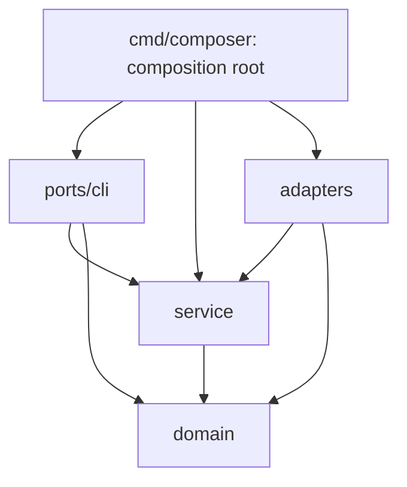

# Архитектура Composer

Composer читает снимки Git, подставляет vars в шаблоны, создаёт сети и применяет
изменения через Compose SDK. Типы приложений и маршрутизация описываются в
GitOps-репозитории.

## Репозиторий и окружения

Каждый каталог `apps/<namespace>/<app>` задаёт независимый Compose project.
Для каждой пары namespace/environment Composer создаёт bridge-сеть до запуска
параллельных выкаток. Функция `network "stage" "demo"` возвращает имя сети и
добавляет её в список создаваемых. Остальные external networks нужно создать заранее.

Окружения задаются в `source.branches`. Каждое читает свою ветку целиком.
Prod использует `base.yaml`, остальные окружения добавляют `stage.yaml`.
Отсутствующий `stage.yaml` выключает приложение вне prod; пустой включает.
`enabled: false` выключает проект. Словари объединяются рекурсивно, списки и скаляры
заменяются, `null` удаляет ключ.

`run` перечитывает host YAML перед каждым проходом. Ошибка конфига сохраняет
последние принятые настройки. Изменения `installation`, `state_dir`, `docker`
и `build_auth` требуют перезапуска агента. Имена окружений начинаются со строчной
латинской буквы и содержат строчные латинские буквы, цифры и дефисы, до 63 символов.

## Применение изменений

1. Получить снимок коммита каждой ветки через go-git.
2. Расшифровать vars, применить overrides и отрендерить конфиги, Dockerfile и Compose.
3. Сравнить хэш модели с последним успешным применением.
4. Создать сети.
5. В пределах `parallelism` собрать недостающие образы и вызвать Compose Up или Down.
6. После успешного применения сохранить хэш.

`run` получает новые снимки каждый проход. `apply --wait` удерживает первый успешно
полученный снимок каждого окружения и повторяет попытки до успеха или таймаута.
Ошибка чтения или рендеринга сохраняет текущее окружение и не блокирует остальные.
Ошибка сети блокирует только её потребителей. Блокировка процесса не допускает
одновременную работу агентов с одним `state_dir`.

Сборка образа завершается до Up; её ошибка сохраняет прежние контейнеры и хэш.
Перед Up/Down прежний хэш удаляется, чтобы частичная ошибка не скрыла последующий
Git revert. Маркер `attempted` сохраняет проект в inventory даже при неудачном Up.
Удаления обрабатываются и после перезапуска агента. Тома, образы и сети namespace
сохраняются.

Compose SDK управляет контейнерами, масштабированием и ожиданием готовности.
Одна попытка ожидания ограничена `max(1s, poll_interval)`. На всю операцию с checkout
и сборкой отводится `deploy_timeout`. Между повторными попытками могут стартовать
другие проекты даже при `parallelism: 1`. Порядка запуска между проектами нет.

Composer пропускает успешно применённые проекты без изменений и не исправляет
ручные изменения в Docker. Для повторного применения остановите агент и удалите
`state_dir/deployments/<env>/<project>/applied`. При потере каталога состояния
теряется и учёт проектов, уже удалённых из Git. Отчёты выводятся как JSON lines,
ошибки идут в stderr.

## Шаблоны и конфиги

Шаблоны получают `.Vars`, `.Secrets`, `.Installation`, `.Env`, `.Environments`,
`.Namespace`, `.App` и `.Runtime` (`ProjectName`, `NetworkName`, `Image`). Helpers:
`toYAML`, `toJSON`, `quote`, `indent`, `get`, `default`, `dict`, `list`, `merge`, `network`.
Файлы без `.tmpl` копируются без изменений. Compose interpolation отключён:
подстановки выполняют Go templates, `$` в значениях сохраняется буквально.

Готовые конфиги сохраняются в каталог по хэшу содержимого и признака исполняемости.
Bind path и label `io.composer.config` меняются вместе с конфигом, поэтому Compose
пересоздаёт контейнеры даже при прежнем образе. Изменение `deploy.replicas` сохраняет
config path/label и не пересоздаёт прежние реплики.

[Секреты](secrets.md) расшифровываются до merge. Повторное шифрование прежних
значений не меняет модель. [Сборка из исходников](builds.md) использует кэш Docker;
конфиги влияют на образ только через переменные, использованные в Dockerfile.

## Код

```text
cmd/composer/                 composition root, host YAML, bootstrap, lifecycle
internal/app/composer/
  domain/                     Project, Manifest, Change, Snapshot, Report, BuildSpec
  service/
    reconcile/                snapshot → render → plan → apply, polling/retry
    deployment/               сравнение ревизий, удаления, network barrier, workers
    build/                    image lookup → checkout → build, singleflight
  ports/
    cli/                      Cobra, flags, JSON DTO и ошибки для пользователя
  adapters/
    git/                      snapshots, exact SHA checkout, SSH/HTTPS
    gitops/                   vars/SOPS/templates, configs, Compose validation
      internal/vars/          приватный YAML merge и SOPS
    docker/                   Compose lifecycle, Engine и embedded BuildKit
    state/                    inventory, applied/attempted markers, build workspace
    systemd/                  установка unit/binary и вызовы systemctl
```

| Слой | Может зависеть от | Не может зависеть от |
|---|---|---|
| `domain` | Чистые средства стандартной библиотеки | Service, ports, adapters, SDK, YAML, файловый/сетевой ввод-вывод |
| `service` | Domain, другие use cases, context/time, errgroup/singleflight | Ports, adapters, SDK, Cobra, host config, файловая система |
| `ports/cli` | Domain/service-контракты, Cobra, presentation DTO | Конкретные адаптеры, host YAML loader, Docker/Git SDK |
| `adapters/<dependency>` | Domain/service-контракты, свой SDK, своё поддерево | Другие адаптеры, inbound ports |
| `cmd/composer` | Все слои | Бизнес-правила сравнения ревизий и выкатки |



Стрелки показывают импорты. Service вызывает адаптеры через интерфейсы,
объявленные у потребителя в `service/*/ports.go`:

- `reconcile`: Source, Renderer, Deployer, Inventory.
- `deployment`: Inventory, Journal, Backend, Builder.
- `build`: Source, Backend, Workspace.

`cmd/composer` создаёт адаптеры, передаёт им настройки и связывает зависимости.
Он владеет host YAML, process lock и закрытием Docker client. Решения о polling,
retry и порядке операций принадлежат service; файловый IO выполняет `adapters/state`.

Compose SDK model остаётся внутри GitOps/Docker adapters. Между ними передаётся
`domain.Manifest` с rendered document, WorkingDir и ConfigHash. Domain и service
не разбирают Compose schema. CLI преобразует domain.Report в JSON DTO без
manifest и секретов.

`make go/architecture` проверяет границы через Vixar platform; `make go/lint`
включает эту проверку. Команды проверок и генерации mocks описаны в
[CONTRIBUTING.md](../CONTRIBUTING.md).
