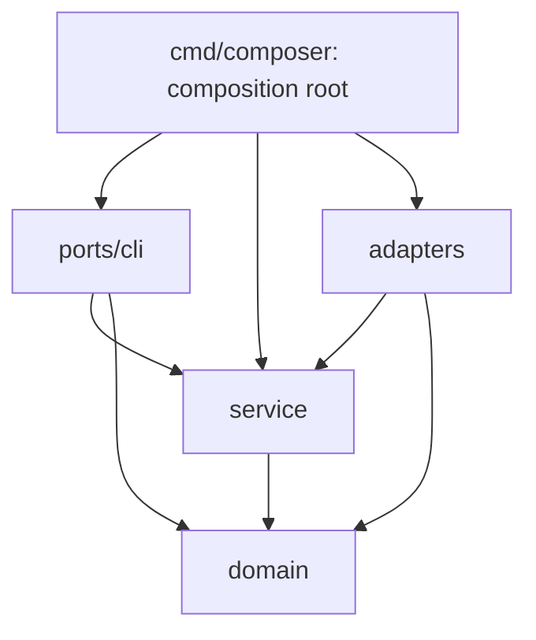

# Архитектура Composer

Composer — небольшой механизм Git → templates → Compose. Он знает соглашение о каталогах и окружениях, но не назначение приложений. Исключений для nginx, HAProxy, БД или «edge» в Go-коде нет.

## Репозиторий

```text
apps/
  <namespace>/
    <name>/
      Dockerfile.tmpl     # при build.repository/build.commit
      vars/
        base.yaml
        stage.yaml       # optional: включает stage
      configs/
        <любое имя>.tmpl
        <статический файл>
templates/
  compose.yaml.tmpl      # optional: общий override
```

Нет корневых stage/prod и специального каталога edge. Шаблон по умолчанию входит в Composer; сервисы и их настройки задаются vars репозитория. Несколько сервисов одного Compose project допустимы. Собственный общий шаблон может использовать произвольную структуру vars.

Namespaces определяются каталогами. Для каждой пары namespace/environment создаётся отдельная bridge-сеть до начала параллельных выкаток. Дополнительные сети описываются обычным Compose. External networks, кроме автоматически создаваемых namespace networks, должны существовать к моменту использования.

В templates доступен helper `network "stage" "demo"`: имя сети указанной пары
в текущей `.Installation`, включая штатное сокращение и hash имени. Вызов также добавляет сеть в список сетей проекта: Composer создаёт её
до Compose operations, даже если в целевом окружении ещё нет работающих приложений. GitOps example
использует helper для явного подключения внешнего nginx к сетям nginx всех окружений.

Prod использует base, все остальные окружения — base + stage. Отсутствующий stage.yaml выключает stage; пустой включает. Maps объединяются рекурсивно, списки/скаляры заменяются, null удаляет ключ. `enabled: false` выключает project. В первую очередь меняются base-настройки, чтобы stage оставался близок к prod.

Единственный список окружений — `source.branches`. Перед каждым `run`-проходом
Configuration port возвращает новые inputs и policy. При ошибке Runner сохраняет
последние принятые настройки. Общий inventory читает исторические окружения,
чтобы удаление работало и после restart. `.Environments` доступен шаблонам;
маршрутизация и выбор сервисов остаются в GitOps.

## Один проход

1. Получить committed snapshot каждого окружения из настроенной ветки через go-git.
2. Для каждого каталога и окружения расшифровать SOPS vars, объединить их и отрендерить configs, Dockerfile и Compose.
3. Сравнить хэш модели с файлом последнего успешного применения.
4. Создать отсутствующие сети namespace.
5. В ограниченном числе goroutines подготовить source image, затем вызвать SDK Up для изменений; Down — для удалений.
6. После успешного Up атомарно записать хэш. Ошибка одного project не отменяет остальные.

Повторный проход run обновляет snapshots; apply --wait удерживает первый успешный snapshot каждого окружения. Ошибка чтения или рендеринга исключает только это окружение из планирования, а его scoped inventory предотвращает удаление соседей. Последовательные проходы и process lock исключают одновременную выкатку одного project. Все networks создаются до запуска workers; ошибка сети блокирует её consumers.

Для source build сначала проверяется image в Docker; отсутствующий собирается.
Ошибка checkout/build не меняет прежние контейнеры и applied marker.
После подготовки образа, перед Up/Down удаляется прежний хэш успеха. Это позволяет повторить операцию после частичной ошибки и корректно применить Git revert. Файл attempted отмечает project, который мог быть создан даже при неудачном Up. Удаление затрагивает только такие projects и окружения, явно удалённые из source.branches. Ошибка чтения настроенной ветки не означает удаление. Volumes/images/namespace networks не очищаются автоматически.

Readiness, lifecycle отдельных services, зависимости внутри project и масштабирование выполняет Compose SDK. Composer не содержит своего healthcheck polling, списка контейнеров, state machine или drift-controller. Ожидание readiness одной попытки ограничено max(1s, poll_interval), вся операция project, включая checkout/build, — deploy_timeout. Неудачная попытка повторяется позднее; между попытками могут стартовать другие projects при parallelism=1.

## Config-only и scale

Отрендеренные файлы публикуются в неизменяемом каталоге по хэшу их содержимого и executable mode. Модель получает этот bind path и label `io.composer.config`. Поэтому изменение прочитанного при старте конфига пересоздаёт контейнеры через стандартную логику Compose. Image остаётся прежним.

Хэш всей модели нужен только для пропуска успешного неизменившегося project. Он не записывается в container label. Изменение deploy.replicas меняет этот хэш, сохраняя config path/label: Compose масштабирует project без пересоздания прежних реплик.

Шаблоны получают произвольные vars. Путь `./configs/x` в volumes относится к отрендеренному файлу; путь `/etc/app/x` в command относится к контейнеру. Compose schema проверяет SDK. После Go templates Compose interpolation отключён, чтобы `$` внутри значений не менялся. Дополнительные собственные запреты Compose отсутствуют.

[SOPS + age](secrets.md) расшифровывает каждый vars-файл до merge с проверкой MAC.
Ключ задаётся host-параметром age_key_file вне Git. Изменение секрета проходит
тот же config-only механизм; повторное шифрование прежних значений не меняет
модель. Plaintext vars не сохраняются в snapshots; готовые configs находятся
в закрытом state_dir, включая старые версии до удаления project.

## Сборка source image

`domain.BuildSpec` содержит repository, commit и отрендеренный Dockerfile; `Image()`
вычисляет стабильный тег по этим входам. `domain.Project.Build` передаётся
Builder внутри процесса и не попадает в JSON report. Runtime configs не входят
в image hash, если их значения не изменили Dockerfile template.

`build.Builder` сначала вызывает Backend.HasImage. Если образ существует,
checkout/build не нужны. Иначе Source.Checkout получает exact SHA во временный
закрытый каталог, Backend.Build отправляет его Docker, каталог удаляется.
`singleflight` объединяет только одновременно выполняющиеся сборки одного тега;
завершённые результаты не хранятся. Первый запрос задаёт context общей сборки,
остальные ждут её завершения и cleanup. Образы и build cache принадлежат Docker.

`git.Repository` использует отдельный host build_auth и go-git; `.git` не входит
в build context. `docker.Client.Build` использует embedded BuildKit через
Engine `/grpc` и `/session`, экспортируя image в Docker. Внешний buildx не
используется. Docker registry auth читает Docker config; настроенный credential
helper может требовать внешний executable.

Общий template добавляет `.Runtime.Image` и `pull_policy: never` только сервисам
без собственного image. Stage commit переопределяется обычным vars merge;
при выпуске проверенный SHA переносится в base, override удаляется, stage.yaml
сохраняется. [Примеры и ограничения](builds.md), включая SHA fetch, submodules,
LFS и воспроизводимость base images, описаны отдельно.

## Код

Границы следуют соглашениям Vixar: domain, service, inbound ports и outbound
adapters. Пакета с Go-файлами непосредственно в `internal/app/composer` нет.

```text
cmd/composer/                 composition root, host YAML, bootstrap, lifecycle
internal/app/composer/
  domain/                     Project, Manifest, Change, Snapshot, Report, BuildSpec
  service/
    reconcile/                snapshot → render → plan → apply, polling/retry
    deployment/               сравнение ревизий, удаления, network barrier, workers
    build/                    image lookup → checkout → build, singleflight
  ports/
    cli/                      Cobra, flags, JSON DTO и ошибки для пользователя
  adapters/
    git/                      snapshots, exact SHA checkout, SSH/HTTPS
    gitops/                   vars/SOPS/templates, configs, Compose validation
      internal/vars/          приватный YAML merge и SOPS
    docker/                   Compose lifecycle, Engine и embedded BuildKit
    state/                    inventory, applied/attempted markers, build workspace
    systemd/                  установка unit/binary и вызовы systemctl
```

| Слой | Может зависеть от | Не может зависеть от |
|---|---|---|
| `domain` | Чистые средства стандартной библиотеки | Service, ports, adapters, SDK, YAML, файловый/сетевой ввод-вывод |
| `service` | Domain, другие use cases, context/time, errgroup/singleflight | Ports, adapters, SDK, Cobra, host config, файловая система |
| `ports/cli` | Domain/service-контракты, Cobra, presentation DTO | Конкретные адаптеры, host YAML loader, Docker/Git SDK |
| `adapters/<dependency>` | Domain/service-контракты, свой SDK, своё поддерево | Другие адаптеры, inbound ports |
| `cmd/composer` | Все слои | Бизнес-правила сравнения ревизий и выкатки |



Стрелки показывают импорты. Во время выполнения service вызывает адаптеры через
собственные интерфейсы из `service/*/ports.go`. `ports/cli` — входной адаптер;
исходящие порты принадлежат потребителю в service, а не отдельному общему реестру.

`reconcile` потребляет Source/Renderer/Deployer и Inventory. `deployment`
потребляет Inventory для чтения состояния, Journal для записи переходов,
Backend для сетей/Up/Down и Builder для подготовки image. `build` потребляет
Source, Backend и Workspace. Конструкторы адаптеров возвращают конкретные типы;
`cmd/composer` передаёт их через эти интерфейсы, без DI framework.

Host YAML, credentials и transport options остаются у composition root. Он
передаёт каждому адаптеру собственные options, а сервисам — только параметры
политики: parallelism, deadlines и poll interval. Процесс также владеет lock и
закрытием Docker client. Bootstrap-контракт CLI связывает технические команды
init/check/install/export и открытие runtime с composition root; в CLI нет
конструирования клиентов. `Runner.Run` владеет решением о повторе; CLI отображает
отчёт и задаёт общий timeout из флага.

### Модели и внешние форматы

Domain не содержит типов Compose SDK или JSON/YAML-тегов. `Manifest` — непрозрачный
отрендеренный документ с рабочим каталогом и config hash. Service не разбирает
его содержимое. GitOps-адаптер валидирует документ через Compose и вычисляет hash
по прежнему canonical JSON; Docker-адаптер восстанавливает SDK-модель перед Up.
Это сохраняет полную Compose schema, включая disabled profiles и models,
которые не входят в `Project.MarshalJSON`. Собственной копии Compose schema нет.

Domain также определяет включение stage только при наличии override и требование
полного immutable commit SHA. GitOps-адаптер применяет эти правила при разборе;
build use case повторно проверяет commit до обращения к Git/Docker.

CLI преобразует domain.Report в отдельные Report/ProjectReport DTO с прежним
JSON-контрактом. Manifest, пути и build inputs в вывод не попадают. Настройки
приложений по-прежнему произвольные vars, известные только GitOps-адаптеру.

### Состояние и проверка зависимостей

Service решает, когда инвалидировать успех, записать попытку, сохранить hash
или удалить deployment. `adapters/state` выполняет только эти файловые операции,
сохраняя прежнюю структуру и атомарный rename. Ошибка build остаётся перед
инвалидированием marker; частичная ошибка Up не скрывает Git revert.

`make go/architecture` запускает структурный checker Vixar platform;
`PLATFORM_DIR` задаёт расположение platform. Линтер также использует конфигурацию
platform напрямую, без локальных allowlists Composer.

`make go/lint` выполняет architecture check, vet и lint. Integration-файлы
проверяются тем же конфигом с `--build-tags=integration`; команда приведена в CONTRIBUTING.md.
`make go/generate` воспроизводит mocks. Полные сценарии через CLI находятся в
`cmd/composer/*_integration_test.go`, unit-тесты service используют mocks,
проверки markers с настоящей файловой системой — в `adapters/state`.

## Инфраструктурный пример и следующие шаги

[GitOps example](https://github.com/dmironenko/composer-example) описывает внешний nginx + Certbot
перед отдельными prod/stage nginx. Готовый jonasal/nginx-certbot обслуживает
HTTP-01, выпуск, продление и reload; собственных TLS scripts нет. Локально
используется встроенный CA образа, сертификаты сохраняются в Docker volumes.
Общий gateway читается из prod-ветки, внутренний stage nginx — из stage-ветки.

GitHub Actions не требуется. Composer читает настроенные ветки, валидирует
snapshot и применяет изменения самостоятельно. Для отдельной проверки есть
`composer validate`; stage настраивается через vars/stage.yaml. Ветка задаётся
конфигом, в наших примерах master.

Начальная схема пустой БД задаётся versioned init. Миграции существующей БД выполняются вручную. Итоговый критерий — одна команда apply --wait на свежем host с установленными Docker, Composer и credentials, без ручной подготовки сетей и образов.
